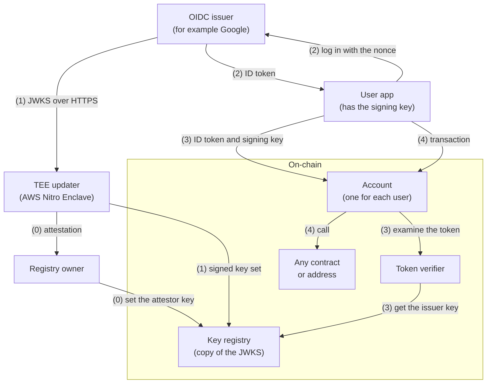
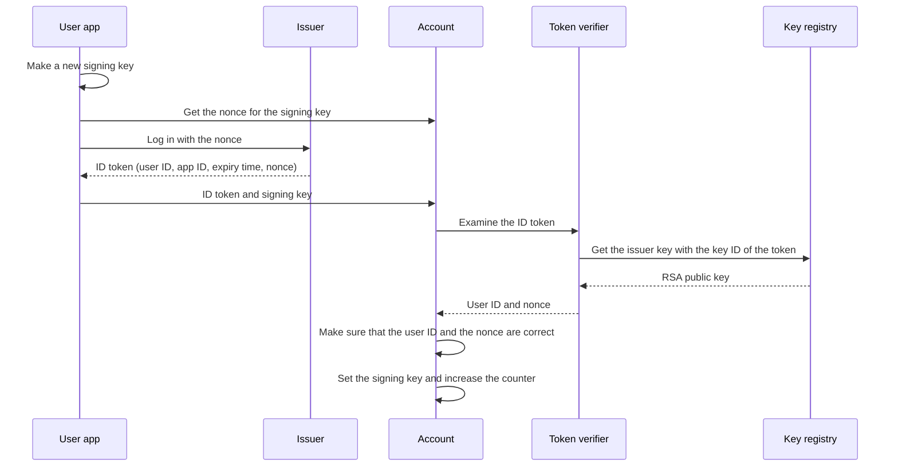

# OIDC smart account

This proof of concept lets a user control a smart account with an OIDC login, for example a Google login.

The user logs in at the issuer, for example Google. The issuer gives an ID token. The account examines the ID token and then sets a signing key. Then the signing key sends transactions from the account. If the app loses the signing key, the user logs in again and sets a new signing key.

> [!WARNING]
> This code has no audit. Do not use it with real funds.

## Concepts

| Term | Meaning |
| --- | --- |
| Issuer | The OIDC provider, for example Google. It logs in the user and signs ID tokens with its RSA keys. |
| ID token | A JSON Web Token (JWT) that the issuer signs. It contains the user ID (`sub`), the app ID (`aud`), the expiry time (`exp`), and a nonce that the app selects. |
| JWKS | The list of the public keys of the issuer. The issuer shows this list at a fixed HTTPS URL. The issuer changes its keys at intervals. |
| TEE updater | A program in a trusted execution environment (TEE), an AWS Nitro Enclave. It gets the JWKS over HTTPS and signs a copy for the chain. |
| Attestor key | The key that the TEE updater uses to sign the copies of the JWKS. The enclave makes this key, and the key never leaves the enclave. |
| Attestation | A document that AWS signs. It shows which program runs in the enclave and the public part of the attestor key. |
| Signing key | A usual Ethereum key that the app makes for the user. After the account accepts an ID token for this key, the key can send transactions from the account. |

## Architecture



The system has four parts:

- The **TEE updater** copies the JWKS of the issuer to the chain. The contracts trust it to copy only the real keys of the issuer.
- The **key registry** keeps the current copy of the JWKS. It accepts only a copy that the attestor key signed.
- The **token verifier** examines an ID token: the RSA signature, the issuer, the app ID, and the time.
- The **account** is for one user. It accepts an ID token only for its user and for one new signing key. Then this signing key can send transactions from the account.

The steps in the diagram are:

0. **Set the attestor key.** The TEE updater makes its attestor key in the enclave. It gives an attestation of the key to the registry owner. The owner examines the attestation on a trusted computer. Then the owner sets the attestor key in the key registry. Do this step again after each start of the enclave.
1. **Copy the keys to the chain.** The TEE updater gets the JWKS over HTTPS. TLS ends in the enclave. Thus the host computer cannot change the keys. The TEE updater signs the keys and the time. Anyone can send this signed key set to the key registry. Do this step at least one time each day.
2. **Log in.** The app makes a new signing key and gets the nonce for this key from the account. The user logs in at the issuer with this nonce. The issuer gives an ID token that contains the user ID and the nonce.
3. **Set the signing key.** Anyone can send the ID token and the signing key to the account. The account asks the token verifier to examine the token. If the token is correct, the account sets the signing key.
4. **Send transactions.** The signing key sends transactions from the account.

### How the nonce protects the login

The nonce connects one login to one signing key. The account calculates the nonce as a hash of four values:

- the chain ID,
- the address of the account,
- the address of the new signing key,
- a counter in the account. Each new signing key increases the counter.

Thus an ID token can set only the signing key that the app selected, on one account and one chain, and only one time. If a different person gets a copy of the ID token, that person cannot use it for a different key.



## Security

### What each part examines

The **TEE updater** gets the JWKS only over HTTPS, with a correct certificate. It keeps only the keys that the token verifier can use: RSA keys for RS256 signatures with the exponent 65537. It ignores other keys.

The **key registry** accepts a key set only if:

- the attestor key signed it for this registry, this chain, and this JWKS URL;
- its time is after the time of the current key set and after the last change of the attestor key.

Thus nobody can put back an old key set. A change of the attestor key also removes all keys. If the key set is older than one day, the registry gives no keys.

The **token verifier** accepts an ID token only if:

- the algorithm is RS256, and the header has no `crit` member;
- the registry has the key with the key ID (`kid`) of the token, and the RSA signature is correct;
- the issuer (`iss`) and the app ID (`aud`) are the configured values;
- the expiry time (`exp`) is after the current time, and the start time (`nbf`), if the token has one, is not after the current time.

The **account** accepts an ID token only if the user ID (`sub`) is the user of the account and the nonce is correct.

### Trust and limits

- **Issuer.** The account trusts the issuer to authenticate the user. A person who can log in as the user can set a new signing key immediately. The change has no delay, and nobody can cancel it.
- **TEE updater.** The attestor key signs only keys that the enclave code got over TLS. The attestation shows which code has the key. A defect in this code, in AWS Nitro, or in the TLS root certificates can put a false key or a false time on the chain.
- **Registry owner.** One address sets the attestor key. If an attacker gets control of this address, the attacker can set a false attestor key.
- **Effect of a false key.** With a false key in the registry, an attacker can make an ID token for any user. Then the attacker can set the signing key of each account that uses the registry.
- **Host and relayers.** They can stop or delay the key updates, but they cannot change the keys. If there is no update for one day, nobody can set a new signing key. The current signing keys continue to work.
- **Privacy.** The ID token is public on the chain. Ask the issuer only for the `openid` scope. Then the token does not contain the email address or the name of the user.
- **Account deployment.** Anyone can deploy an account for any user ID and with any token verifier. Before you send funds to an account, make sure that it has the correct token verifier and user ID.
- **Token format.** The app ID (`aud`) must be one string, not a list. The claims that the verifier uses must be strings without escape characters. The verifier does not use `iat` and `azp`. OIDC Core makes the `azp` check optional when `aud` has one value.
- **Not tested on AWS.** The enclave image builds, but the enclave mode has not run on a Nitro instance. Refer to the [TEE updater README](tee-updater/README.md).
- **Out of scope.** More than one signing key, multisig owners, recovery delays, passkeys, ERC-4337, and upgrades.

## Run the demo

The demo runs the full flow on a local Anvil chain with a mock issuer. It runs the TEE updater in local mode, without an enclave.

Necessary tools: [Foundry](https://getfoundry.sh), Rust, Node.js, and curl.

```bash
git submodule update --init
./demo/run.sh
```

The script does these steps:

1. It deploys the contracts and sets the attestor key.
2. It copies the keys of the mock issuer to the key registry.
3. It deploys the account of the user `alice`.
4. It sets a signing key with an ID token. Then the signing key sends 0.5 ETH from the account.
5. It makes sure that the same ID token cannot set a signing key a second time.

The transaction that sets a signing key uses approximately 430,000 gas.

## Build and test

The project uses Foundry 1.8.5, solc 0.8.37, OpenZeppelin Contracts 5.7.0, forge-std 1.17.0, and Rust 1.99.0 with alloy 1.7.

```bash
forge test
```

```bash
cd tee-updater && cargo test
```

The Foundry tests sign ID tokens on the chain with a fixed test RSA key. A Solidity test and a Rust test expect the same key set hash and signature. Thus, if only one side changes the encoding, a test fails.

## Use with Google

Deploy the contracts with these values:

| Value | For Google |
| --- | --- |
| JWKS URL (key registry) | `https://www.googleapis.com/oauth2/v3/certs` |
| Issuer (token verifier) | `https://accounts.google.com` |
| App ID (token verifier) | The OAuth client ID of your web app |
| User ID (account) | The Keccak-256 hash of the Google `sub` of the user |

```bash
forge create src/JWKSRegistry.sol:JWKSRegistry --broadcast --rpc-url "$RPC_URL" --private-key "$PRIVATE_KEY" \
  --constructor-args "$OWNER" https://www.googleapis.com/oauth2/v3/certs
forge create src/JWTVerifier.sol:JWTVerifier --broadcast --rpc-url "$RPC_URL" --private-key "$PRIVATE_KEY" \
  --constructor-args "$REGISTRY" https://accounts.google.com "$CLIENT_ID"
forge create src/OIDCAccount.sol:OIDCAccount --broadcast --rpc-url "$RPC_URL" --private-key "$PRIVATE_KEY" \
  --constructor-args "$VERIFIER" "$(cast keccak "$GOOGLE_SUB")"
```

Then run the TEE updater in an enclave. Refer to the [TEE updater README](tee-updater/README.md).

To get an ID token, send the user to Google with `scope=openid` and the nonce from the account. The nonce depends on the account address, and the account contains the hash of the user ID. Thus the app must know the user ID before it asks for the ID token, for example from an earlier login.

## Repository layout

```text
src/           Contracts: key registry, token verifier and its JSON parser, and account
script/        Sends a signed key set to the key registry
test/          Foundry tests and the mock issuer for the tests
tee-updater/   Rust TEE updater: local mode and AWS Nitro Enclave mode
demo/          Mock issuer (Node.js) and the end-to-end demo script
```
