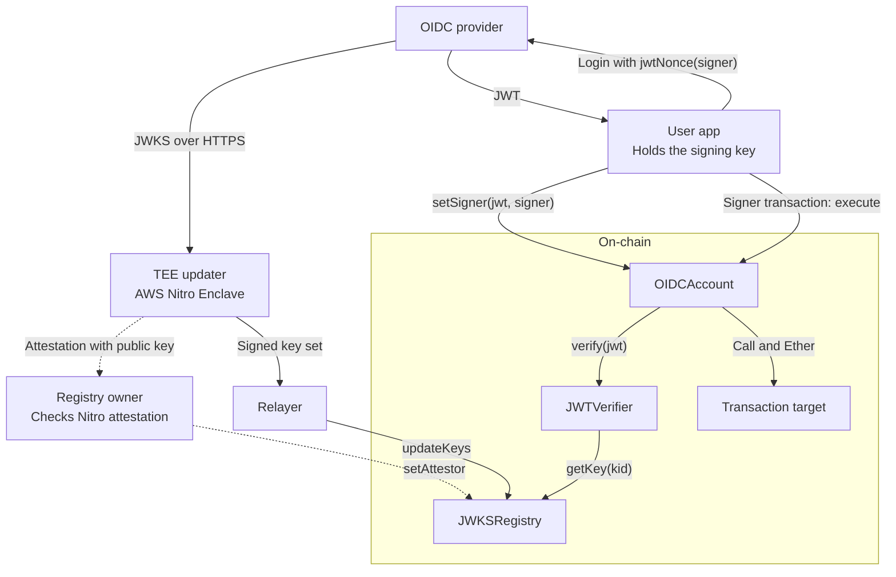

# OIDC smart account

This prototype lets an OIDC user set one account signing key with an ID token (JWT).
The signing key can then send transactions from the account.

1. A TEE updater gets the provider's public keys (JWKS) over HTTPS and signs a key set.
2. A relayer publishes the signed key set on-chain.
3. The user gets a JWT that approves one signing key. The account verifies the JWT and sets the signer.
4. The signer calls the account to send Ether or call another contract.

This is a demo. It has no audit. Use test funds only.

## Architecture



TLS ends in the enclave. The host forwards encrypted bytes. The enclave keeps its signing key in
memory. Before enrollment, the owner verifies the AWS attestation signature, the image measurements,
and a new random challenge on a trusted computer. See the [TEE setup](tee-updater/README.md).

## Contract rules

| Contract | Rule |
| --- | --- |
| [JWKSRegistry](src/JWKSRegistry.sol) | One fixed owner sets the TEE attestor. Anyone can relay a key set that the attestor signed. Each set replaces all keys. An empty set removes all keys. |
| [JWTVerifier](src/JWTVerifier.sol) | Verifies an RS256 signature with a current registry key. Checks the provider, audience, authorized party, and token times. |
| [OIDCAccount](src/OIDCAccount.sol) | One fixed subject identifies the user. A JWT sets one signer. Only that signer can call `execute`. Target errors cause the account call to revert with the same data. |

The signed key set binds the JWKS URI, chain ID, registry address, keys, and fetch time. The fetch time
must be after the previous set and must not be after the block time. `setAttestor` removes all keys and
sets this time limit to its block time. Start the next fetch after that second. Wait for a block whose
time is at least the fetch time before you relay the snapshot. Publish a new set more than once per
day: `getKey` rejects a set that is older than one day.

The JWT must have:

- `alg` equal to `RS256`, a known `kid`, and no `crit` header;
- `iss` and `aud` equal to the configured values;
- `azp` equal to `aud`, if the token has `azp`;
- `exp` after the block time, and `nbf` at or before it, if the token has `nbf`;
- the account's `sub`, and `nonce` equal to `account.jwtNonce(newSigner)`.

`jwtNonce` returns `keccak256(abi.encode(chainId, account, newSigner, nonce))` as lowercase hex with a
`0x` prefix. Each signer change increases the account nonce. This binds the JWT to one signer, account,
chain, and use. A new valid JWT can replace the signer.

## Run the demo

Install Foundry, Rust (see [rust-toolchain.toml](rust-toolchain.toml)), Node.js, and curl.

```bash
git submodule update --init
./demo/run.sh
```

The script starts Anvil and a mock provider. It uses the updater in local mode, publishes the JWKS,
sets the signer for `alice`, sends 0.5 ETH, and checks that JWT replay fails. Local mode has no TEE
protection. The mock provider does not authenticate users.

## Build and test

```bash
forge fmt --check
forge test
cargo fmt --manifest-path tee-updater/Cargo.toml --check
cargo clippy --manifest-path tee-updater/Cargo.toml --all-targets -- -D warnings
cargo test --manifest-path tee-updater/Cargo.toml
```

Foundry pins Solidity 0.8.37 and the Osaka EVM. The Git submodules pin the Solidity libraries.
`Cargo.lock` pins the Rust dependencies. Tests cover key publication, JWT checks, signer changes,
transaction calls, and replay rejection. Solidity and Rust tests share an EIP-712 digest and signature
test vector.

## Use a real provider

Deploy the contracts in this order:

| Contract | Constructor values |
| --- | --- |
| `JWKSRegistry` | Owner address, provider JWKS URI |
| `JWTVerifier` | Registry address, exact `iss`, OAuth client ID (`aud`) |
| `OIDCAccount` | Verifier address, `keccak256(bytes(sub))` |

The [Google discovery document](https://accounts.google.com/.well-known/openid-configuration) gives
`https://www.googleapis.com/oauth2/v3/certs` as the JWKS URI and `https://accounts.google.com` as the
issuer. Enroll the enclave attestor and publish its key set as described in the
[TEE setup](tee-updater/README.md).

The app must know the user's `sub` before it deploys the account, for example from an earlier login.
It then reads `account.jwtNonce(signer)` and uses that value as the OIDC login `nonce`. Request only the
`openid` scope to reduce personal data in the JWT (see [Google's OIDC guide](https://developers.google.com/identity/openid-connect/openid-connect)). Send the returned ID token to
`account.setSigner(jwt, signer)`. The signer can then call `account.execute(target, value, data)`.

## Limits and trust

- The account trusts the provider to authenticate the user. Anyone who can log in as that user can set a new signer.
- The registry trusts one owner and one attestor. A false registry key permits false JWTs for every account that uses the registry.
- The host or relayer can stop updates. After one day, this stops signer changes. The current signer can still execute transactions.
- The JWT is public transaction data. It can contain personal data, even with a limited scope.
- The updater accepts only RS256 signature keys with exponent 65537 and an odd 2048-bit modulus. Its HTTP client checks `Content-Length` when present and rejects transfer encoding.
- [JWTParser](src/JWTParser.sol) reads the top-level fields that verification needs. It does not fully validate ignored JSON values. Used strings must have no escapes. `aud` must be one string. The verifier ignores `iat`.
- Verify the account's `verifier()` and `subjectHash()` before use. Anyone can deploy another account with other values.
- AWS enclave operation needs a test on a Nitro instance. Local tests do not verify that deployment.

Multisig, multiple account signers, recovery delays, ERC-4337, passkeys, and upgrades are out of scope.

## Files

| Directory | Content |
| --- | --- |
| `src/` | Registry, JWT verifier and parser, account |
| `script/` | Signed key set relay |
| `tee-updater/` | Updater, attestation verifier, Nitro setup |
| `test/` | Contract tests and test provider |
| `demo/` | Mock provider and local demo |
