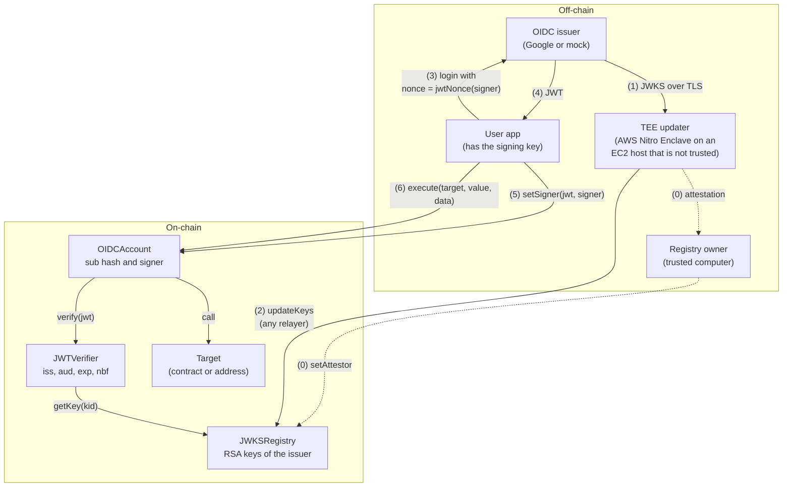

# OIDC smart account

This proof of concept lets an OIDC user, for example a Google user, control a smart account. The user logs in at the issuer. The ID token (JWT) from this login sets a signing key on the account. Then the signing key sends transactions from the account.

**Status:** proof of concept. There is no audit. Do not use it with real funds.

## Architecture



0. **Enroll the TEE.** The TEE updater makes an attestor key in the enclave memory. The registry owner examines the Nitro attestation of the enclave on a trusted computer. Then the owner calls `setAttestor`.
1. **Get the JWKS.** The TEE updater gets the JWKS of the issuer over HTTPS. TLS ends in the enclave. Thus the parent instance cannot change the keys.
2. **Publish the keys.** The TEE updater signs the key set. Anyone can send the signed key set to `JWKSRegistry.updateKeys`.
3. **Log in.** The user app makes a signing key and reads `account.jwtNonce(signer)`. The user logs in at the issuer with this value as the OIDC `nonce`.
4. **Get the JWT.** The issuer gives a JWT that contains the `sub` of the user and the nonce.
5. **Set the signer.** Anyone sends `account.setSigner(jwt, signer)`. The account verifies the JWT with `JWTVerifier`, which gets the RSA key from `JWKSRegistry`. Then the account sets the signer.
6. **Send transactions.** The signer calls `account.execute(target, value, data)`.

## Contracts

| Contract | Function |
| --- | --- |
| [`JWKSRegistry`](src/JWKSRegistry.sol) | Keeps the RSA keys of one issuer. Each signed key set replaces all keys. `getKey` reverts when the key set is older than one day. |
| [`JWTVerifier`](src/JWTVerifier.sol) | Verifies an RS256 JWT for one issuer and one audience (OAuth client ID). It returns the hashes of `sub` and `nonce`. [`JWTParser`](src/JWTParser.sol) reads the JSON. |
| [`OIDCAccount`](src/OIDCAccount.sol) | Account of one user. `setSigner(jwt, signer)` sets the signer. `execute(target, value, data)` sends a call from the account. Only the signer can call `execute`. |

The registry accepts a key set only if:

- the attestor signed it (EIP-712) for the JWKS URI, the chain ID, and the address of the registry;
- its fetch time is after the current key set and after the last `setAttestor`.

Thus a relayer cannot put back an old key set. `setAttestor` also removes all keys, because the old attestor signed them.

The verifier accepts a JWT only if:

- `alg` is `RS256`, and the header has no `crit` member;
- the key with the `kid` of the JWT is in the current key set, and the RSA signature is correct;
- `iss` and `aud` are equal to the configured values;
- `exp` is after the block time, and `nbf` (if there is one) is not after the block time.

The account accepts a JWT only if `sub` is the subject of the account, and `nonce` is equal to `jwtNonce(newSigner)`. This value is `keccak256(abi.encode(chainId, account, newSigner, nonce))` as lowercase hex with the `0x` prefix. Each `setSigner` increases the account `nonce`. Thus a JWT can set only the signer that the user selected, on one account and one chain, and only one time.

## Trust and limits

- **Issuer.** The account trusts the issuer to authenticate the user. A person who can log in as the user can set a new signer immediately. There is no delay and no cancel.
- **TEE updater.** The attestor key signs only key sets that the enclave code got over TLS. The Nitro attestation shows which code has the key. A defect in this code, in AWS Nitro, or in the TLS root certificates can put a false key on-chain.
- **Registry owner.** One address sets the attestor. If an attacker gets this key, the attacker can set a false attestor.
- **Impact of a false key.** With a false key in the registry, an attacker can sign a JWT for any `sub`. Then the attacker can set the signer of each account that uses the registry.
- **Host and relayers.** They can stop or delay updates, but they cannot change the keys. If there is no update for one day, `setSigner` stops. The signer can continue to use `execute`.
- **Privacy.** The JWT is public calldata. Ask the issuer only for the `openid` scope, so that the JWT does not contain the email or the name.
- **Account deployment.** Anyone can deploy an account for any `sub` and with any verifier. Before you send funds to an account, make sure that `verifier()` and `subjectHash()` have the correct values.
- **Parser.** `aud` must be one string, not an array. The claims that the verifier uses must be strings without escapes. The verifier ignores `iat` and `azp`. OIDC Core makes the `azp` check optional when `aud` has one value.
- **Not tested on AWS.** The enclave image builds, but the enclave mode of the TEE updater has not run on a Nitro instance. See [`tee-updater/README.md`](tee-updater/README.md).
- **Out of scope:** multisig owners, more than one signer, recovery delays, passkeys, ERC-4337, and upgrades.

## Run the demo

The demo runs the full flow on a local Anvil chain with a mock issuer. It uses the TEE updater in local mode, without an enclave.

Necessary tools: [Foundry](https://getfoundry.sh), Rust, Node.js, and curl.

```bash
git submodule update --init
./demo/run.sh
```

The script deploys the contracts, sets the attestor, publishes the mock JWKS, and deploys the account of the user `alice`. Then it sets a signer with a JWT, sends 0.5 ETH from the account, and makes sure that the same JWT does not work a second time. `setSigner` uses approximately 427,000 gas.

## Build and test

The project uses Foundry 1.8.5, solc 0.8.37 (EVM version Osaka), OpenZeppelin Contracts 5.7.0, forge-std 1.17.0, and Rust 1.99.0 ([`rust-toolchain.toml`](rust-toolchain.toml)).

```bash
forge test
```

```bash
cd tee-updater && cargo test
```

The Foundry tests sign JWTs on-chain with a fixed test RSA key ([`MockIssuer`](test/helpers/MockIssuer.sol)). A Solidity test and a Rust test expect the same key set digest and signature. Thus, if only one side changes the encoding, a test fails.

## Use with Google

Deploy with these values:

| Value | For Google |
| --- | --- |
| JWKS URI (`JWKSRegistry`) | `https://www.googleapis.com/oauth2/v3/certs` |
| Issuer (`JWTVerifier`) | `https://accounts.google.com` |
| Audience (`JWTVerifier`) | The OAuth client ID of your web application |

```bash
forge create src/JWKSRegistry.sol:JWKSRegistry --broadcast --rpc-url "$RPC_URL" --private-key "$PRIVATE_KEY" \
  --constructor-args "$OWNER" https://www.googleapis.com/oauth2/v3/certs
forge create src/JWTVerifier.sol:JWTVerifier --broadcast --rpc-url "$RPC_URL" --private-key "$PRIVATE_KEY" \
  --constructor-args "$REGISTRY" https://accounts.google.com "$CLIENT_ID"
forge create src/OIDCAccount.sol:OIDCAccount --broadcast --rpc-url "$RPC_URL" --private-key "$PRIVATE_KEY" \
  --constructor-args "$VERIFIER" "$(cast keccak "$GOOGLE_SUB")"
```

Then run the TEE updater in an enclave ([`tee-updater/README.md`](tee-updater/README.md)). To get the JWT, send the user to Google with `scope=openid` and `nonce=<account.jwtNonce(signer)>`. The account keeps the hash of the Google `sub`, and the nonce contains the account address. Thus the application must know `sub` before it asks for the JWT, for example from an earlier login.

## Repository layout

```text
src/           JWKSRegistry, JWTVerifier, JWTParser, OIDCAccount
script/        UpdateKeys.s.sol: sends a signed key set to the registry
test/          Foundry tests and the mock issuer for the tests
tee-updater/   Rust TEE updater: local mode and AWS Nitro Enclave mode
demo/          Mock issuer (Node.js) and the end-to-end demo script
```
