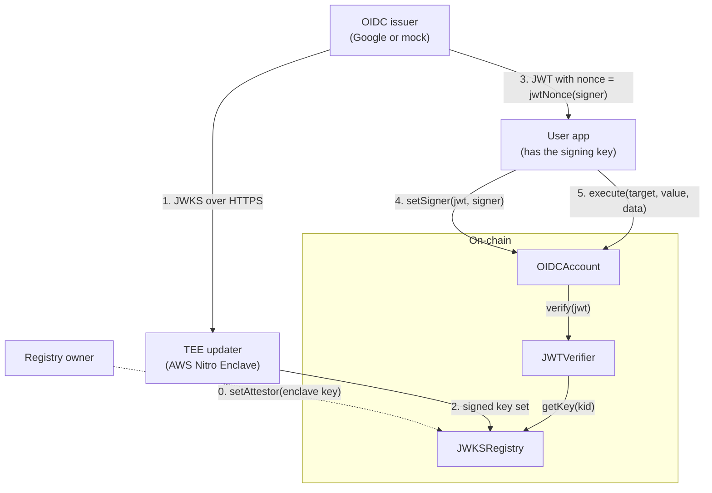

# OIDC smart account

This proof of concept shows how a smart contract can identify an OIDC user, for example a Google user.

1. A TEE updater (AWS Nitro Enclave) gets the public keys (JWKS) of the issuer and puts them on-chain.
2. The user gets an ID token (JWT) from the issuer. The JWT `nonce` approves one new signing key.
3. The account verifies the JWT on-chain and sets the signing key.
4. The signing key sends transactions from the account.

**Status:** proof of concept. There is no audit. Do not use it with real funds.

## Architecture



0. The owner examines the Nitro attestation of the enclave. Then the owner sets the attestor: the enclave key that signs key sets.
1. The TEE updater gets the JWKS of the issuer over HTTPS. TLS ends in the enclave, so the host cannot change the keys.
2. The TEE updater signs the key set. Anyone can send the signed key set to `JWKSRegistry.updateKeys`.
3. The user app makes a signing key and reads `account.jwtNonce(signer)`. The user logs in at the issuer with this nonce. The issuer gives a JWT that contains the user `sub` and the nonce.
4. Anyone sends `account.setSigner(jwt, signer)`. The account verifies the JWT with `JWTVerifier` and sets the signer.
5. The signer calls `account.execute(target, value, data)`. Only the signer can do this.

## Contracts

| Contract | Function |
| --- | --- |
| [`JWKSRegistry`](src/JWKSRegistry.sol) | Keeps the RSA keys of one issuer. It accepts a key set only if the attestor signed it for the JWKS URI of the registry. The key set must also be newer than the current key set. `getKey` reverts when the key set is older than one day. |
| [`JWTVerifier`](src/JWTVerifier.sol) | Verifies an RS256 JWT for one issuer and one audience (OAuth client ID). It returns the hashes of `sub` and `nonce`. [`JWTParser`](src/JWTParser.sol) reads the JSON. |
| [`OIDCAccount`](src/OIDCAccount.sol) | Account of one user. `setSigner(jwt, signer)` sets the signer. `execute(target, value, data)` sends a call from the account. |

The JWT nonce is `keccak256(abi.encode(chainId, account, signer, nonce))` as lowercase hex. Thus a JWT can set only the signer that the user selected, on one account and one chain, and only one time.

The verifier makes sure that:

- `alg` is `RS256` and the header has no `crit` member;
- a key with the `kid` of the JWT is in the current key set, and the RSA signature is correct;
- `iss` and `aud` are the configured values, and `azp` (if there is one) is equal to `aud`;
- `exp` is after the block time, and `nbf` (if there is one) is not after the block time.

## Trust and limits

- **Issuer.** The account trusts the issuer to authenticate the user. A person who can log in as the user can set a new signer immediately. There is no delay and no cancel.
- **TEE updater.** The attestor key signs only key sets that the enclave code got over TLS. The Nitro attestation shows which code has the key. A defect in this code, in AWS Nitro, or in the TLS root certificates can put a false key on-chain.
- **Registry owner.** One address sets the attestor. If an attacker gets this key, the attacker can set a false attestor.
- **Host and relayers.** They can stop or delay updates, but they cannot change the keys. If there is no update for one day, `setSigner` stops. The signer can continue to use `execute`.
- **Privacy.** The JWT is public calldata. Ask the issuer only for the `openid` scope, so that the JWT does not contain the email or the name.
- **Parser.** `aud` must be one string, not an array. The claims that the verifier uses must be strings without escapes. The verifier ignores `iat`.
- **Out of scope:** more than one signer, recovery delays, multisig owners, passkeys, ERC-4337, and upgrades.
- **Not tested on AWS:** the enclave mode of the TEE updater has not run on a Nitro instance. See [`tee-updater/README.md`](tee-updater/README.md).

## Run the demo

The demo runs the full flow on a local Anvil chain with a mock issuer. It uses the TEE updater in local mode, without an enclave.

Necessary tools: [Foundry](https://getfoundry.sh), Rust, Node.js, and curl.

```bash
git submodule update --init
./demo/run.sh
```

The script deploys the contracts, sets the attestor, publishes the mock JWKS, and deploys the account of the user `alice`. Then it sets a signer with a JWT, sends 0.5 ETH from the account, and shows that the same JWT does not work a second time. `setSigner` uses approximately 420,000 gas.

## Build and test

```bash
forge test
```

```bash
cd tee-updater && cargo test
```

The Foundry tests sign JWTs on-chain with a fixed test RSA key ([`MockIssuer`](test/helpers/MockIssuer.sol)). A Solidity test and a Rust test expect the same key set digest and signature. Thus, if only one side changes the encoding, a test fails.

## Use with Google

Deploy with these values:

| Value | For Google |
| --- | --- |
| JWKS URI (`JWKSRegistry`) | `https://www.googleapis.com/oauth2/v3/certs` |
| Issuer (`JWTVerifier`) | `https://accounts.google.com` |
| Audience (`JWTVerifier`) | The OAuth client ID of your web application |

```bash
forge create src/JWKSRegistry.sol:JWKSRegistry --broadcast --rpc-url "$RPC_URL" --private-key "$PRIVATE_KEY" \
  --constructor-args "$OWNER" https://www.googleapis.com/oauth2/v3/certs
forge create src/JWTVerifier.sol:JWTVerifier --broadcast --rpc-url "$RPC_URL" --private-key "$PRIVATE_KEY" \
  --constructor-args "$REGISTRY" https://accounts.google.com "$CLIENT_ID"
forge create src/OIDCAccount.sol:OIDCAccount --broadcast --rpc-url "$RPC_URL" --private-key "$PRIVATE_KEY" \
  --constructor-args "$VERIFIER" "$(cast keccak "$GOOGLE_SUB")"
```

Then run the TEE updater in an enclave ([`tee-updater/README.md`](tee-updater/README.md)). To get the JWT, send the user to Google with `scope=openid` and `nonce=<account.jwtNonce(signer)>`. The account keeps the hash of the Google `sub`, and the nonce contains the account address. Thus the application must know `sub` before it asks for the JWT, for example from an earlier login.

## Repository layout

```text
src/           JWKSRegistry, JWTVerifier, JWTParser, OIDCAccount
script/        UpdateKeys.s.sol: sends a signed key set to the registry
test/          Foundry tests and the mock issuer for the tests
tee-updater/   Rust TEE updater: local mode and AWS Nitro Enclave mode
demo/          Mock issuer (Node.js) and the end-to-end demo script
```
