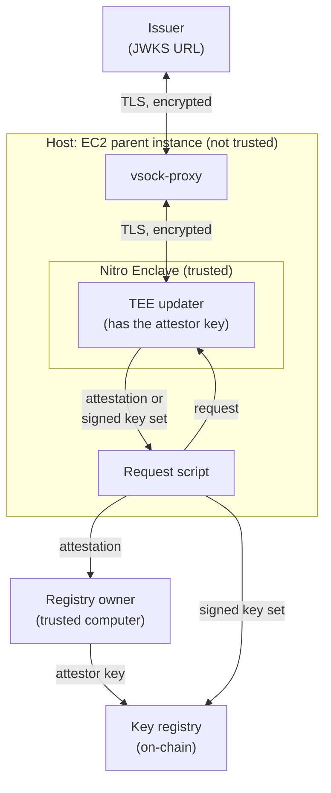

# TEE updater

The TEE updater copies the JWKS of an OIDC issuer to the key registry contract. It gets the JWKS over HTTPS and signs it with the attestor key. It runs in an AWS Nitro Enclave. For tests and demos, it can also run on a usual computer (local mode).

**Status:** The demo uses the local mode, and the Docker image builds. The enclave mode has not run on a Nitro instance.

## Security boundary



- TLS ends in the enclave. The host (the parent EC2 instance) only moves encrypted bytes between the enclave and the issuer. Thus the host cannot change the JWKS.
- When the enclave starts, it makes the attestor key from random bytes of the Nitro Secure Module (NSM). The key never leaves the enclave memory.
- An attestation document shows the measurement of the enclave image (PCR0) and the public part of the attestor key. AWS signs the document. The registry owner examines it before the owner sets the attestor key.
- The time comes from the NSM, not from the host. The enclave uses this time for the TLS certificate check and for the key set. It reads the time before the HTTPS request. Thus a slow host can only make the key set older.
- The attestor signs the keys and the time together with the JWKS URL, the chain ID, and the address of the key registry. Thus the signature is correct only for one JWKS URL and one key registry.
- The host can stop or delay the updates. This design cannot prevent that.

The updater keeps only RSA keys for RS256 signatures with the exponent 65537, because the token verifier cannot use other keys. As RFC 7517 recommends, other keys do not cause an error. If the JWKS has no such key, the key set is empty, and it removes all keys from the registry.

## Local mode

Run these commands in the repository root:

```bash
cargo run --manifest-path tee-updater/Cargo.toml -- sign \
  --jwks-uri https://www.googleapis.com/oauth2/v3/certs \
  --chain-id 31337 \
  --registry "$REGISTRY" \
  --private-key "$ATTESTOR_KEY" > key-set.json
```

The private key is a usual secp256k1 key. Use this mode only for tests and demos. The output is the signed key set. Anyone can send it to the key registry. The file is not trusted data. Thus the script takes the registry address from `REGISTRY`, not from the file. The registry examines the signature of the keys and the time:

```bash
REGISTRY="$REGISTRY" KEY_SET="$(cat key-set.json)" forge script script/UpdateKeys.s.sol \
  --rpc-url "$RPC_URL" --private-key "$PRIVATE_KEY" --broadcast
```

## Enclave mode

Necessary items: an EC2 instance with Nitro Enclaves, `nitro-cli`, `vsock-proxy`, Docker, Python 3, and Foundry. You must also have a second computer that you trust, because the host is not trusted. Run the commands in the repository root.

1. Build the Docker image and the enclave image file (EIF):

   ```bash
   docker build -t tee-updater tee-updater
   nitro-cli build-enclave --docker-uri tee-updater --output-file tee-updater.eif
   ```

   The output shows PCR0, the measurement of the full image. Use the PCR0 of a build that you trust. For example, build the EIF on the trusted computer and copy it to the host. Do not trust a value that the host shows.

2. Start the proxy from the enclave to the JWKS host. The allowlist in [`vsock-proxy.yaml`](vsock-proxy.yaml) must contain this host.

   ```bash
   vsock-proxy 8443 www.googleapis.com 443 --config tee-updater/vsock-proxy.yaml &
   ```

3. Start the enclave. Do not use `--debug-mode`. The host can read the memory of a debug-mode enclave. Such an enclave has a zero PCR0, and the attestation check rejects it.

   ```bash
   nitro-cli run-enclave --eif-path tee-updater.eif --cpu-count 2 --memory 512
   ```

   Write down the `EnclaveCID` as `CID`.

4. Set the attestor key. On the trusted computer, make a new random challenge:

   ```bash
   CHALLENGE=0x$(openssl rand -hex 32)
   ```

   On the host, ask the enclave for an attestation with this challenge:

   ```bash
   python3 tee-updater/scripts/request.py --cid "$CID" \
     "{\"operation\":\"attest\",\"challenge\":\"$CHALLENGE\"}" > attestation.json
   ```

   Copy `attestation.json` to the trusted computer. Examine it there:

   ```bash
   ATTESTOR=$(cargo run --quiet --release --manifest-path tee-updater/Cargo.toml \
     --bin verify-attestation -- --response attestation.json --challenge "$CHALLENGE" --pcr0 "$PCR0")
   ```

   The tool examines the AWS signature and the certificate chain of the document. Then it compares PCR0 and the challenge, and it shows the address of the attestor key. The new random challenge makes sure that the document is new. Then the owner sets the attestor key:

   ```bash
   cast send "$REGISTRY" "setAttestor(address)" "$ATTESTOR" --rpc-url "$RPC_URL" --private-key "$OWNER_KEY"
   ```

5. Send a key set immediately after step 4. Then send a key set at intervals, for example each hour. A new key of the issuer is on the chain only after the next key set. The registry does not give keys from a key set that is older than one day. The time of each key set must be after step 4 and after the current key set.

   ```bash
   python3 tee-updater/scripts/request.py --cid "$CID" \
     "{\"operation\":\"sign\",\"jwksUri\":\"https://www.googleapis.com/oauth2/v3/certs\",\"chainId\":$CHAIN_ID,\"registry\":\"$REGISTRY\"}" > key-set.json
   REGISTRY="$REGISTRY" KEY_SET="$(cat key-set.json)" forge script script/UpdateKeys.s.sol \
     --rpc-url "$RPC_URL" --private-key "$PRIVATE_KEY" --broadcast
   ```

When the enclave starts again, it has a new attestor key. Do step 4 and step 5 again. A change of the attestor key removes all keys from the registry.

## Code

| File | Function |
| --- | --- |
| [`src/lib.rs`](src/lib.rs) | JWKS reader, the EIP-712 hash of a key set, signatures, and attestation checks |
| [`src/http.rs`](src/http.rs) | HTTP/1.0 GET over a stream that the caller opens: TCP in local mode, vsock in the enclave |
| [`src/main.rs`](src/main.rs) | The `sign` command (local mode) and the `serve` command (enclave mode) |
| [`src/nitro.rs`](src/nitro.rs) | Attestation documents, random bytes, and time from the Nitro Secure Module |
| [`src/bin/verify-attestation.rs`](src/bin/verify-attestation.rs) | Examines an attestation document outside the enclave |
| [`scripts/request.py`](scripts/request.py) | Sends one request to the enclave from the host |

```bash
cd tee-updater
cargo fmt --check
cargo clippy --all-targets -- -D warnings
cargo test
```
